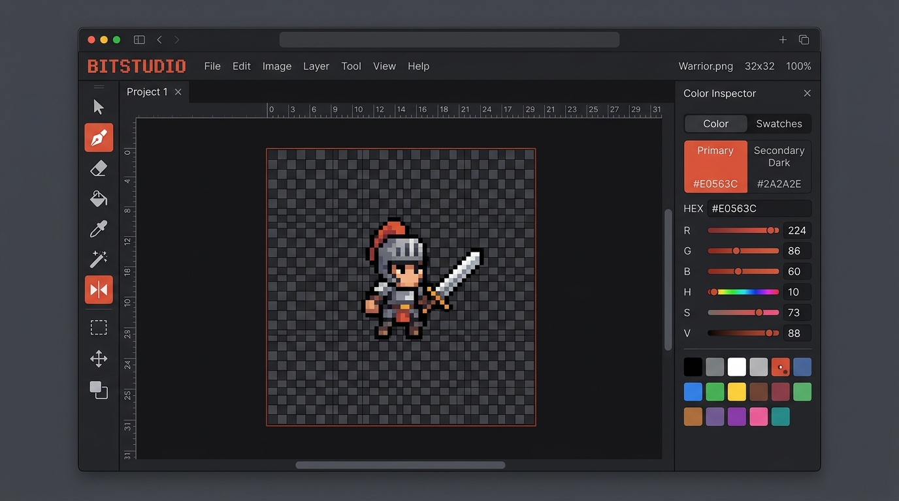

# BitStudio — Pixel Art Editor

A crisp, responsive, browser-based pixel art editor built with vanilla HTML5, CSS3, and modern JavaScript. Inspired by retro sprite tools and modern creative workstations, BitStudio provides an intentional, clutter-free creative environment without templates, generic marketing filler, or bloated dependencies.

 *(generated preview)*

---

## Highlights & Features

- **Precision Drawing Tools**:
  - **Pen / Pencil (`B`)**: Continuous click-and-drag drawing with Bresenham line interpolation to eliminate gaps during rapid pointer movements.
  - **Eraser (`E`)**: Seamlessly clear cells back to transparency or custom canvas background color.
  - **Paint Bucket (`G`)**: Iterative, queue-safe 4-way flood fill designed to handle up to 64×64 grids without recursion call-stack issues.
  - **Eyedropper (`I`)**: Sample any color directly from the canvas with instant synchronization across inputs and swatches.
  - **Line Tool (`L`)**: Dynamic drag preview with Bresenham vector line stamping.
  - **Rectangle Tool (`R`)**: Geometric rectangle preview and placement.
- **Symmetry & Modifiers**:
  - **Mirror X**: Horizontal bilateral symmetry mode for character sprites and portraits.
  - **Mirror Y**: Vertical symmetry mode for isometric tiles, icons, and badges.
  - **Adjustable Stroke Sizes**: 1px, 2px, and 3px centered brush widths.
- **Curated Color Palettes**:
  - Preloaded palettes: **Sweet 16 (Classic)**, **Pico-8 (Retro)**, **Game Boy (4-Shade)**, **Cyberpunk Neon**, **Earth & Skin**, and **Monochrome**.
  - **Dual Swatches**: Primary and secondary drawing colors with quick swap (`X`).
  - **Custom Color Picker & Hex Input**: Direct hex code entry and native HTML5 color picker integration.
  - **Custom Swatch Bank**: Save favorite custom colors directly to localStorage.
- **Canvas & Document Controls**:
  - **Multiple Grid Dimensions**: Support for `16×16`, `24×24`, `32×32`, `48×48`, and `64×64`.
  - **Grid Lines Visibility (`H`)**: Toggle crisp 1px cell grid overlay.
  - **Background Styles**: Transparent checkerboard pattern, Solid White, or Solid Dark Studio surface.
  - **Full History**: Deep Undo (`Ctrl+Z`) and Redo (`Ctrl+Y` / `Ctrl+Shift+Z`) with bounded state snapshots.
  - **Local Persistence**: Automatic project auto-save in `localStorage` across page reloads.
- **Import & Export**:
  - **Crisp PNG Export**: Multiplier resolution scaling (`1×`, `4×`, `8×`, `16×`, `32×`) using nearest-neighbor sampling (`imageSmoothingEnabled = false`) with zero grid line artifacts or blurry interpolation.
  - **Image Import**: Load any PNG/JPG/WebP/SVG and downsample directly into the active grid.
- **Responsive 3-Tier Workspaces**:
  - **Desktop (≥1024px)**: Full multi-column workstation with vertical left tools, centered canvas, right inspector cards, and persistent bottom status bar.
  - **Tablet & iPad (600px–1023px)**: Touch-first creative studio with left-side tool shelf, unobstructed center canvas stage, and slide-out inspector drawer for palettes and settings.
  - **Mobile Phone (≤599px)**: Safe-area-aware fixed bottom toolbar with direct 1-tap access to primary tools (Pen, Eraser, Fill, Pick, Line, Rect), live color chip trigger, and setup bottom sheet.
- **Touch-First Drawing Engine**:
  - Pointer Events API integration with explicit `touch-action: none` restricted to the active canvas surface, preventing unintended page scroll while drawing.
  - Accurate fractional coordinate projection that preserves integer pixel precision across responsive screen scaling, pinch zoom, and orientation flips.
  - Global pointer capture and touch release management ensuring drawing strokes never get stuck off-canvas or during finger lift.
- **100% Touch-Accessible Controls (No Keyboard Required)**:
  - Every action that previously relied on keyboard shortcuts (Undo, Redo, Zoom In/Out/Reset, Grid toggle, Color swap, Clear canvas, Stroke sizes 1–3px, Mirror X/Y symmetry, Grid sizes 16–64px, Background modes, Image import, Shortcuts dialog, PNG export) is directly accessible via dedicated, high-contrast touch buttons.

---

## Keyboard Shortcuts

| Shortcut | Action |
| :--- | :--- |
| <kbd>B</kbd> | Pen / Pencil Tool |
| <kbd>E</kbd> | Eraser Tool |
| <kbd>G</kbd> | Paint Bucket (Flood Fill) |
| <kbd>I</kbd> | Eyedropper Tool |
| <kbd>L</kbd> | Line Tool |
| <kbd>R</kbd> | Rectangle Tool |
| <kbd>H</kbd> | Toggle Grid Lines Overlay |
| <kbd>X</kbd> | Swap Primary & Secondary Colors |
| <kbd>Ctrl</kbd> + <kbd>Z</kbd> | Undo Action |
| <kbd>Ctrl</kbd> + <kbd>Y</kbd> / <kbd>Ctrl+Shift+Z</kbd> | Redo Action |
| <kbd>+</kbd> / <kbd>-</kbd> | Zoom In / Zoom Out |
| <kbd>0</kbd> | Reset Zoom to 100% |
| <kbd>C</kbd> | Clear Canvas (with confirmation) |
| <kbd>1</kbd> - <kbd>3</kbd> | Set Stroke Size (1px, 2px, 3px) |
| <kbd>?</kbd> | Open Keyboard Shortcuts Reference |
| <kbd>Esc</kbd> | Close Open Dialog / Modal |

---

## Getting Started

Because BitStudio is written with standard vanilla web technologies, no build tools, npm packages, or compilers are required.

### 1. Run with Python Simple Server
```bash
python3 -m http.server 3000
```
Then open `http://localhost:3000` in your browser.

### 2. Run with Node / npx
```bash
npx serve -l 3000 .
```

---

## Architecture & Implementation Notes

- **Separation of Layers**:
  - `artCanvas`: Represents the canonical sprite pixel data (`gridSize × gridSize`). Stored directly in state as a 1D flat array for fast indexed lookups and memory efficiency.
  - `overlayCanvas`: High-DPI transparent canvas layer positioned directly above the art canvas. Handles 1px grid rendering, hover previews, drag guides, and symmetry markers without polluting the underlying artwork or triggering history mutations.
- **Bresenham's Line Algorithm**:
  - Ensures continuous interpolation between pointer samples, preventing gaps when drawing quickly on high-refresh-rate mouse and touch devices.
- **Flood Fill Engine**:
  - Employs an iterative BFS/stack queue algorithm with a visited `Uint8Array` bitmask, guaranteeing safety against recursion stack overflow errors on 64×64 grids (4,096 cells).
- **Pixel-Perfect Export**:
  - Leverages offscreen canvas rasterization with `ctx.imageSmoothingEnabled = false` to generate crisp, non-blurred PNGs for social sharing, game development engines, or icon sets.
